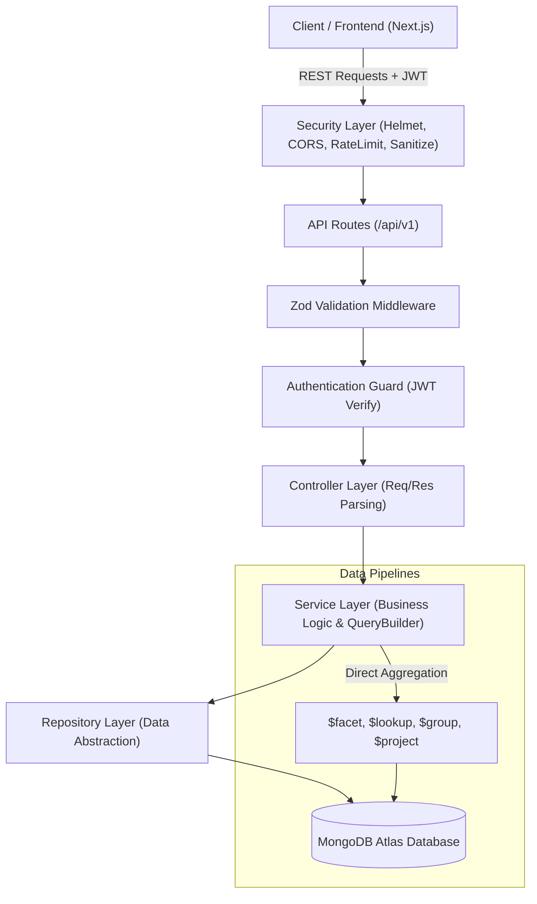
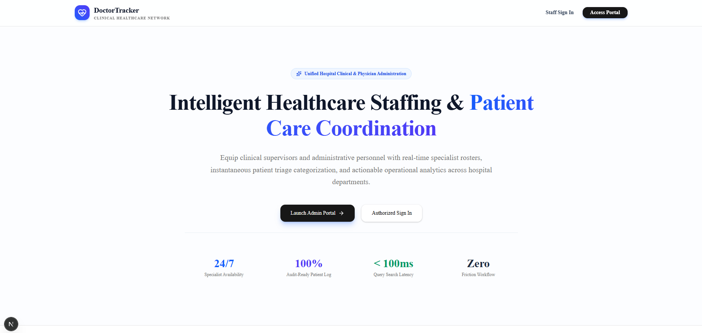
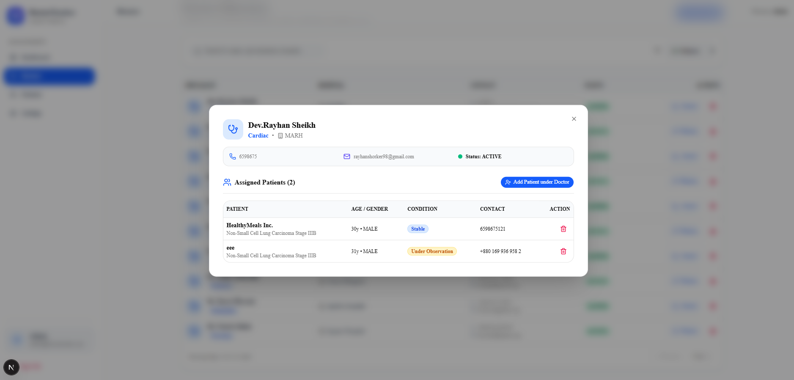
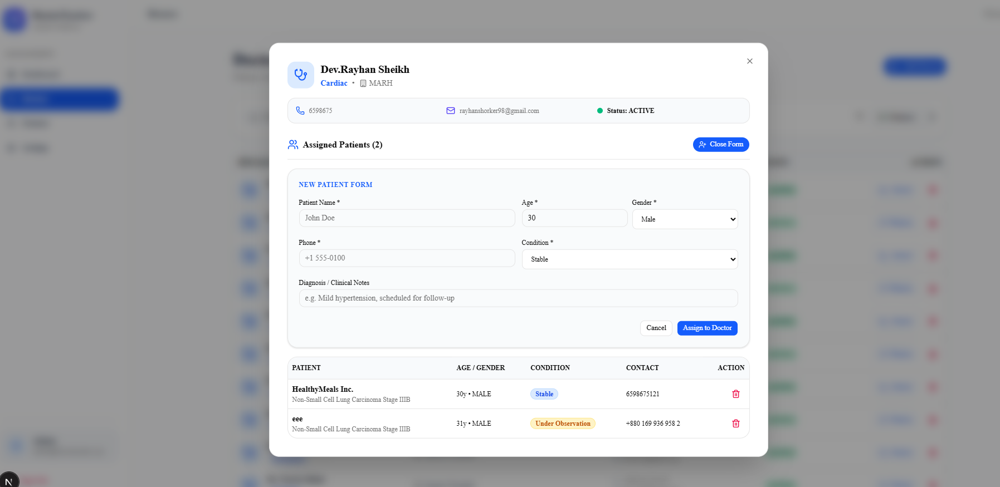
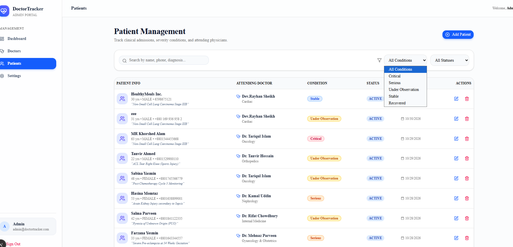
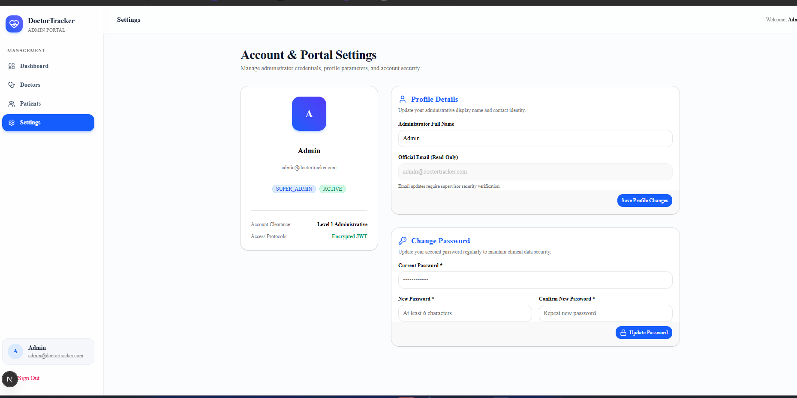
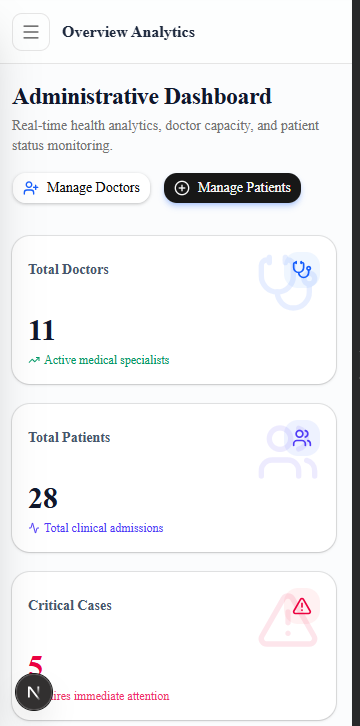
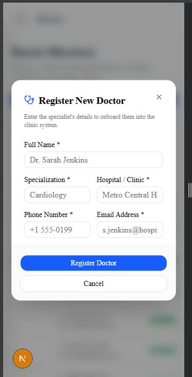
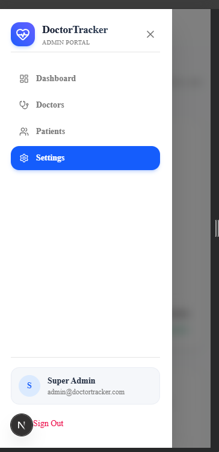

# 🩺 Doctor Tracker – Administrative Portal Backend

[](https://doctor-tracker-frontend-alpha.vercel.app/)
[](https://github.com/dev-rayhan-bd/doctor-tracker-frontend.git)
[](https://github.com/dev-rayhan-bd/doctor-tracker.git)
[](https://www.typescriptlang.org/)
[](https://nodejs.org/)
[](https://expressjs.com/)
[](https://www.mongodb.com/)
[](http://localhost:5001/docs)
[](https://jestjs.io/)

---

## 📌 1. Description (Elevator Pitch)

**Doctor Tracker** is a secure, high-performance administrative web portal designed to streamline medical staff administration and patient management. It empowers authenticated administrators to seamlessly register doctors across hospital specialties, monitor patient admissions and statuses, search and filter records with sub-millisecond database queries, and visualize hospital-wide health metrics through rich, real-time aggregation analytics. Built with clean enterprise architecture, robust multi-tier authentication, and strict input validation, the platform delivers clinical reliability with a lightweight, scalable operational footprint.

---

## ⚙️ 2. Setup Guide

Follow these step-by-step instructions to set up and run the Doctor Tracker backend locally.

### Prerequisites
- **Node.js**: v18.x or v20.x LTS
- **Yarn**: v1.22+ (or npm)
- **MongoDB**: Local MongoDB instance or free MongoDB Atlas cluster

### Step 1: Clone the Repository
```bash
git clone https://github.com/dev-rayhan-bd/doctor-tracker.git
cd doctor-tracker
```

### Step 2: Install Dependencies
```bash
yarn install
```

### Step 3: Configure Environment Variables
Copy the provided `.env.example` file to create your `.env` configuration:
```bash
cp .env.example .env
```
Update `.env` with your MongoDB connection string and SMTP/JWT secrets:
```env
# Server
NODE_ENV=development
PORT=5001
ALLOWED_ORIGINS=http://localhost:3000,http://localhost:5173

# Database (MongoDB Atlas or Local)
DATABASE_URL=mongodb+srv://<username>:<password>@cluster0.example.mongodb.net/doctor_tracker?retryWrites=true&w=majority

# Admin Seeding Credentials
ADMIN_NAME="System Admin"
ADMIN_EMAIL=admin@doctortracker.com
ADMIN_PASSWORD=Admin@123456

# JWT Authentication
JWT_ACCESS_SECRET=your_secret
JWT_ACCESS_EXPIRES_IN=1d
JWT_REFRESH_SECRET=your_secret_key
JWT_REFRESH_EXPIRES_IN=365d

# SMTP (Nodemailer for OTP & Password Reset)
SMTP_HOST=smtp.gmail.com
SMTP_PORT=587
SMTP_USER=your_email@gmail.com
SMTP_PASS=your_app_password
SMTP_FROM="Doctor Tracker <your_email@gmail.com>"
```

### Step 4: Seed Database with Initial Data
Run the automated seed script to populate the Super Admin, 11 doctors across clinical specialties, and 28 linked patients with date-distributed statistics:
```bash
yarn seed
```

### Step 5: Start Development Server
```bash
yarn dev
```
The server will boot up at `http://localhost:5001`.

### Step 6: Run Tests & Build
```bash
# Run unit & endpoint tests
yarn test

# Build TypeScript to production-ready bundle
yarn build

# Run in production mode
yarn start
```

---

## 🏗️ 3. System Architecture

Doctor Tracker is built on the **Clean Modular Layered Architecture**, enforcing separation of concerns, high maintainability, and strict testability:



### Key Architectural Layers:
1. **Routes Layer (`*.routes.ts`):** Defines RESTful endpoints, associates rate limiters, and binds authentication guards.
2. **Validation Layer (`*.validation.ts`):** Validates query parameters, body payloads, and path variables using strict Zod schemas before hitting business logic.
3. **Controller Layer (`*.controller.ts`):** Handles HTTP request headers, invokes corresponding service methods, and wraps payloads with `sendResponse`.
4. **Service Layer (`*.service.ts`):** Encapsulates core business rules, coordinates transactions, and builds database queries via `QueryBuilder`.
5. **Repository Layer (`*.repository.ts`):** Abstract data-access logic from Mongoose ODM queries.
6. **Mongoose Models (`*.model.ts`):** Defines typed schemas with compound indexes (`{ specialization: 1, hospital: 1 }`, `{ doctor: 1, condition: 1 }`, `{ createdAt: -1 }`).

---

## 💡 4. Technical Decisions (Deep Dive)

### Decision 1: Direct MongoDB State & In-Memory Rate Limiting vs. External Redis/BullMQ Dependency

* **Context:** The initial boilerplate relied on external Redis for caching, rate limiting (`rate-limit-redis`), and BullMQ background workers for OTP emails.
* **The Decision:** We replaced the Redis/BullMQ dependency with:
  1. Direct MongoDB atomic fields (`otp`, `otpExpiresAt`, `passwordResetToken`, `passwordResetExpiresAt`) with automatic expiration checks.
  2. Memory-backed express rate limiters for auth and query endpoints.
  3. Direct asynchronous Nodemailer dispatch with non-blocking promises.
* **Trade-Off & Justification:**
  - **Pros:** Eliminates the operational complexity, cost, and single point of failure of managing an external Redis cluster or background worker processes. The application can now be deployed effortlessly on serverless environments (e.g., Vercel, AWS Lambda) or lean Docker containers.
  - **Cons:** In a high-traffic multi-instance horizontally autoscaled cluster, in-memory rate limiting operates per-instance rather than globally.
  - **Why It's Optimal Here:** For an administrative medical portal with controlled concurrency and authenticated staff access, the reliability, simplicity, and zero-latency operational overhead far outweigh the maintenance overhead of managing a distributed Redis fleet. All BullMQ/Redis code remains cleanly commented and modularized if Redis is ever needed in future scale.

---

### Decision 2: MongoDB Single-Trip Aggregation Pipeline (`$facet`, `$lookup`, `$group`) vs. In-Memory Data Processing for Analytics

* **Context:** The Admin Dashboard requires computing multi-dimensional KPIs (total doctors, total patients, condition distribution, patients per doctor, and daily registration trends).
* **The Decision:** We designed a single-trip MongoDB aggregation pipeline utilizing `$facet`, `$lookup`, `$group`, and `$project` in [`src/modules/analytics/analytics.service.ts`](file:///r:/STA/doctor-portal/doctor-tracker/src/modules/analytics/analytics.service.ts) rather than pulling large collections into Node.js memory for JavaScript `Array.filter` or `Array.reduce`.
* **Trade-Off & Justification:**
  - **Pros:** MongoDB executes aggregations natively in C++ using memory-mapped files and compound indexes (`doctor`, `condition`, `createdAt`). The `$facet` stage allows parallel execution of multiple aggregation sub-pipelines in a single database round-trip.
  - **Cons:** Aggregation pipelines require deeper MongoDB query syntax understanding compared to simple JavaScript array operations.
  - **Why It's Optimal Here:** Eliminates network bandwidth saturation and heavy garbage collection cycles in Node.js. Even with tens of thousands of doctor and patient records, the analytics endpoint responds in sub-50ms with pre-formatted data ready for frontend charts (Recharts, Chart.js).

---

## 📖 5. API Documentation (Redocly & Swagger)

Doctor Tracker includes both **Redocly** and **Swagger UI** interactive documentation:

* 🌐 **Modern Redocly UI:** [https://doctor-tracker-9e9c.onrender.com/docs](https://doctor-tracker-9e9c.onrender.com/docs) *(or [http://localhost:5001/redoc](http://localhost:5001/redoc))*
* 📋 **Raw OpenAPI 3.0 Spec:** [http://localhost:5001/docs/swagger.json](http://localhost:5001/docs/swagger.json)

### Core API Summary Table:

| Resource | Method | Endpoint | Description | Auth Required |
| :--- | :---: | :--- | :--- | :---: |
| **Auth** | `POST` | `/api/v1/users/register` | User registration with OTP dispatch | Public |
| **Auth** | `POST` | `/api/v1/users/verify-otp` | Verify 6-digit registration OTP | Public |
| **Auth** | `POST` | `/api/v1/users/resend-otp` | Resend verification code | Public |
| **Auth** | `POST` | `/api/v1/users/login` | Login with JWT token pair | Public |
| **Auth** | `POST` | `/api/v1/users/refresh-token` | Issue new access token | Public |
| **Auth** | `POST` | `/api/v1/users/forgot-password` | Request password reset code | Public |
| **Auth** | `POST` | `/api/v1/users/verify-forgot-password-otp` | Verify reset OTP for resetToken | Public |
| **Auth** | `POST` | `/api/v1/users/reset-password` | Set new password with token/OTP | Public |
| **Auth** | `POST` | `/api/v1/users/change-password` | Change password for logged-in user | `Bearer JWT` |
| **Auth** | `GET` | `/api/v1/users/me` | Current authenticated user profile | `Bearer JWT` |
| **Doctors** | `POST` | `/api/v1/doctors` | Create doctor record | `Bearer JWT` |
| **Doctors** | `GET` | `/api/v1/doctors` | Search, filter, paginate doctors | `Bearer JWT` |
| **Doctors** | `GET` | `/api/v1/doctors/:id` | Doctor details + patient counter | `Bearer JWT` |
| **Doctors** | `PATCH` | `/api/v1/doctors/:id` | Update doctor information | `Bearer JWT` |
| **Doctors** | `DELETE` | `/api/v1/doctors/:id` | Delete doctor and cascade cleanup | `Bearer JWT` |
| **Doctors** | `GET` | `/api/v1/doctors/:id/patients` | List patients under specific doctor | `Bearer JWT` |
| **Doctors** | `POST` | `/api/v1/doctors/:id/patients` | Add new patient directly under doctor | `Bearer JWT` |
| **Patients** | `POST` | `/api/v1/patients` | Register patient under doctor | `Bearer JWT` |
| **Patients** | `GET` | `/api/v1/patients` | Dedicated Patient Page list (Search/Filter/Paginate) | `Bearer JWT` |
| **Patients** | `GET` | `/api/v1/patients/:id` | Patient details with populated doctor | `Bearer JWT` |
| **Patients** | `PATCH` | `/api/v1/patients/:id` | Update patient record | `Bearer JWT` |
| **Patients** | `DELETE` | `/api/v1/patients/:id` | Delete patient record | `Bearer JWT` |
| **Analytics** | `GET` | `/api/v1/analytics/dashboard` | Dashboard KPIs, trends & charts data | `Bearer JWT` |

---

## 📸 6. Visual Evidence (UI & Application Walkthrough)

### 🖥️ Desktop Experience

#### 1. Intelligent Healthcare Landing Page


#### 2. Secure Portal Sign In & Authentication
<p align="center">
  
</p>

#### 3. Administrative Dashboard & Real-Time Analytics
> Includes real-time KPI metrics (*Total Doctors: 11*, *Total Patients: 28*, *Critical Cases: 5*), Patients per Doctor load balancing bar chart, and Clinical Severity donut distribution.


#### 4. Doctors Management Directory
> Features instant search, specialization filters, clinical hospital details, active badges, and pagination.


#### 5. Doctor Onboarding & Registration Modal


#### 6. Doctor Details & Assigned Patients Overview


#### 7. Direct Patient Assignment under Doctor


#### 8. Dedicated Patient Management Page
> Comprehensive patient tracking with clinical condition filters (*Critical*, *Serious*, *Under Observation*, *Stable*, *Recovered*), attending doctor attribution, and edit/delete actions.


#### 9. Account & Portal Settings (Profile & Password Security)


---

### 📱 Mobile Responsive Experience

| Mobile Dashboard & KPIs | Mobile Doctor Onboarding | Mobile Responsive Navigation |
| :---: | :---: | :---: |
|  |  |  |

---

## 🔑 7. Credentials & Submission Information

| Resource / Entity | Details / URL |
| :--- | :--- |
| **Live Frontend Application (Vercel)** | [https://doctor-tracker-frontend-alpha.vercel.app/](https://doctor-tracker-frontend-alpha.vercel.app/) |
| **Frontend GitHub Repository** | [https://github.com/dev-rayhan-bd/doctor-tracker-frontend.git](https://github.com/dev-rayhan-bd/doctor-tracker-frontend.git) |
| **Backend GitHub Repository** | [https://github.com/dev-rayhan-bd/doctor-tracker.git](https://github.com/dev-rayhan-bd/doctor-tracker.git) |
| **Live Backend API Base URL** | `https://doctor-tracker-9e9c.onrender.com/api/v1` *(Local: `http://localhost:5001/api/v1`)* |
| **Live Redocly Documentation** | [https://doctor-tracker-9e9c.onrender.com/docs](https://doctor-tracker-9e9c.onrender.com/docs) *(Local: `http://localhost:5001/docs`)* |
| **Super Admin Login Email** | `admin@doctortracker.com` |
| **Super Admin Login Password** | `Admin@123456` |
| **Production Database** | MongoDB Atlas (Cluster Database: `doctor_tracker`) |
| **Environment Template** | [`.env.example`](file:///.env.example) | 

---

*Doctor Tracker Backend &copy; 2026. Built with modern backend engineering best practices.*
